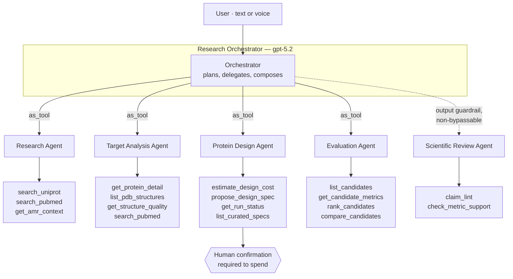
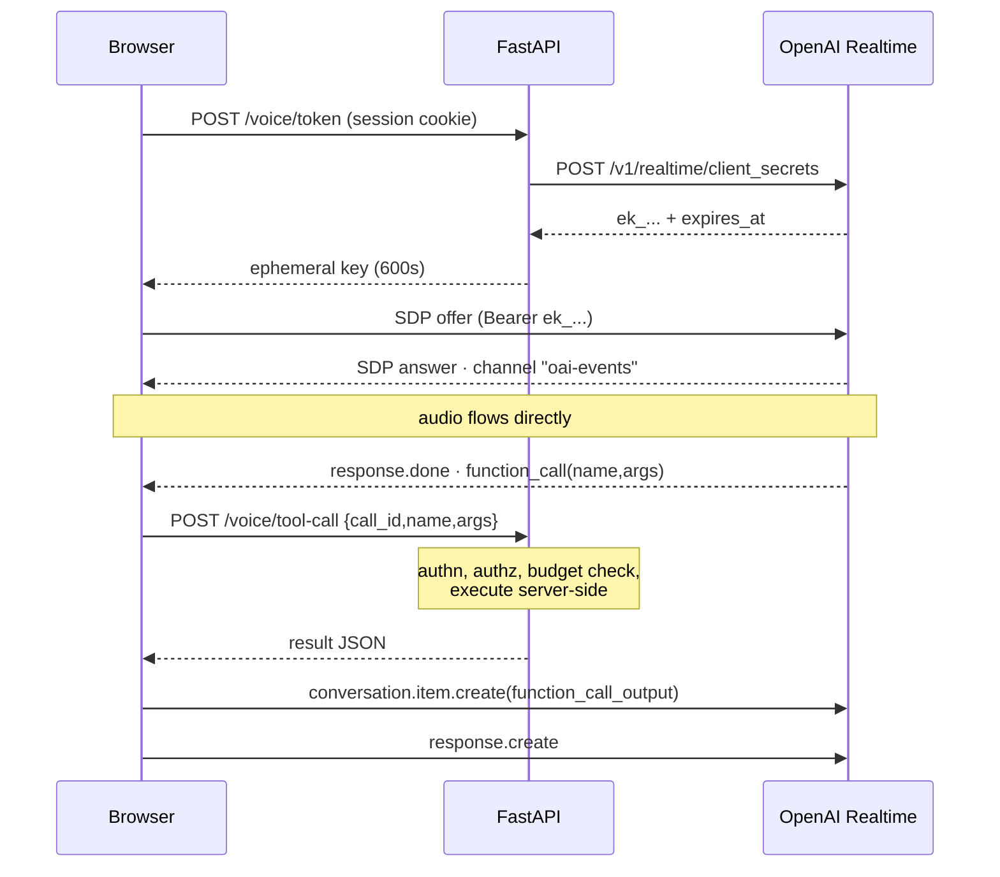
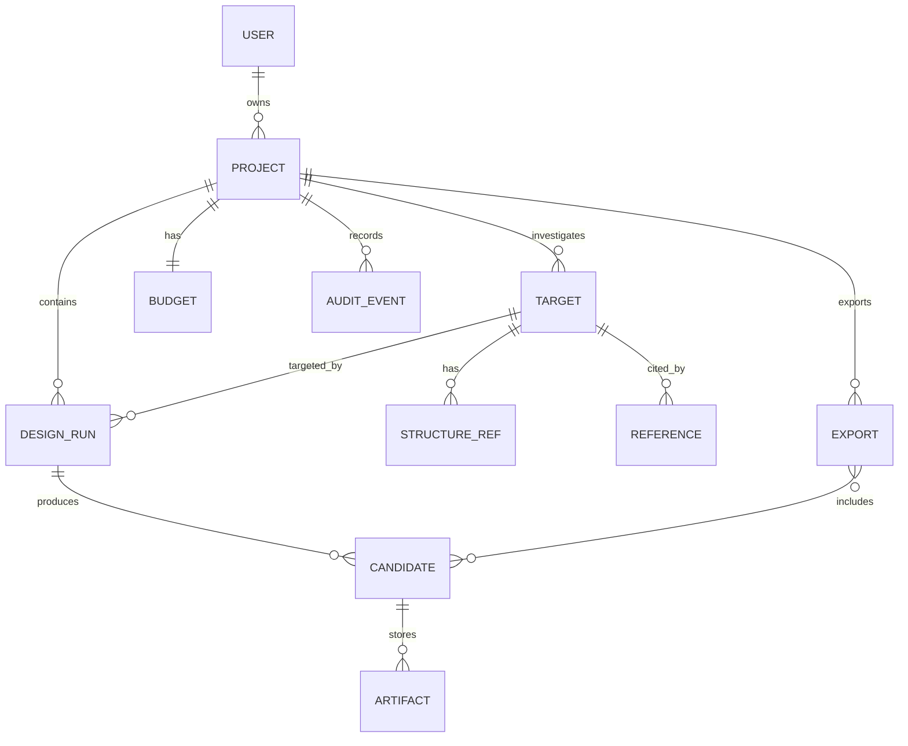
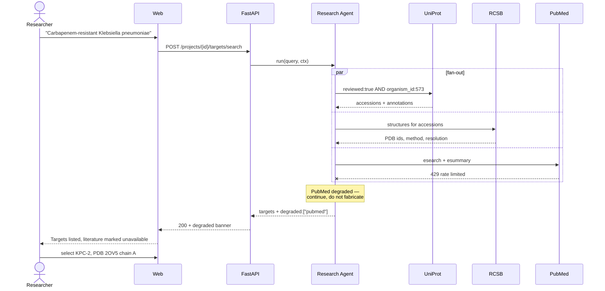
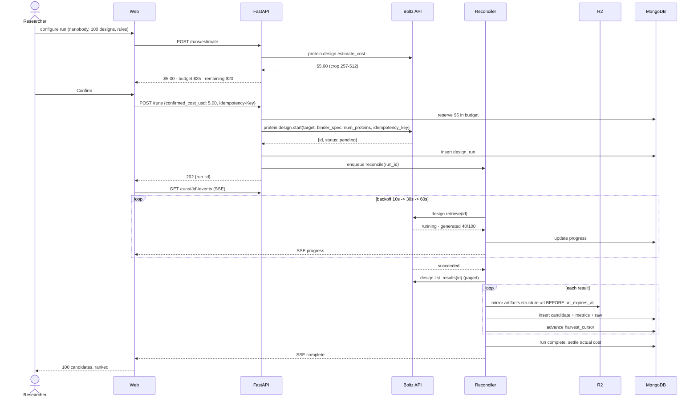
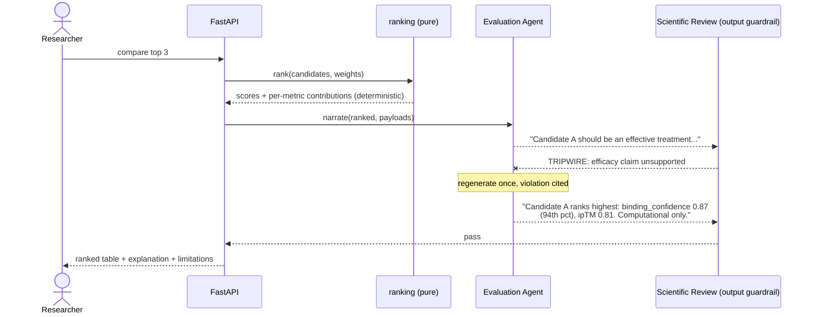

# Biostruct — AI-Powered Therapeutic Protein Design Platform

> **Status: v1 · APPROVED 2026-11-11 · build in progress**
>
> Approved 2026-11-11. Name: **Biostruct** · repo **public** (MIT) · deployment **Railway**.
> Changes from here on are recorded in the decisions log (§17), not by editing history.

Every technical claim here traces to [`docs/research.md`](docs/research.md). The Boltz API details
were verified by installing `boltz-api==0.50.0` and reading its generated types, because Boltz
publishes no API reference.

---

## 1. Overview

**Problem.** Drug-resistant infection is a frontline clinical problem across Africa, but the
computational tools for early therapeutic protein design are scattered across a dozen services and
assume a GPU cluster, an MLOps team and a computational-biology background. A researcher who knows
the clinical problem cannot easily get to a prioritised list of candidate binders.

**Users.**

| User | What they bring | What they lack | What they need from us |
|---|---|---|---|
| **Primary — academic/clinical microbiologist** (African university or research hospital) | Deep knowledge of the pathogen and the local resistance picture | Protein-design expertise, GPUs, budget | Disease → ranked candidates, explained in their language, without choosing a model |
| **Secondary — computational biologist** | Can read ipTM and PAE | Time to glue APIs together | A fast, auditable pipeline they can trust and export from |
| **Tertiary — reviewer / grant panel / collaborator** | Scientific scepticism | Context on how a candidate was produced | A provenance trail and honest uncertainty |

**Core jobs-to-be-done.** Pick an infection → find and understand a protein target → generate
candidate binders → see their structures → evaluate predicted interaction → compare and rank with
reasons → export for the wet lab.

**Success metrics** (measurable, checked at milestone close):

| # | Metric | Target |
|---|---|---|
| S1 | Time from "new project" to a ranked candidate list, for a user who has never used the platform | **< 20 minutes** of wall-clock, **< 6 user decisions** |
| S2 | Share of the KPC-2 reference run's top-10 candidates where the ranking explanation cites only metrics actually present in the result payload | **100%** (claim-lint enforced) |
| S3 | Cost per completed demo project | **< $10**, with `estimate_cost` shown before every spend |
| S4 | Scientific Review guardrail catches overstated efficacy claims in a seeded eval set | **≥ 95%** of 40 seeded claims |
| S5 | Export bundle re-opens in PyMOL/ChimeraX and the sequences round-trip through a FASTA parser | 100% of exports |
| S6 | p95 API latency for non-job endpoints | **< 400 ms** |

**The honest framing, stated once and enforced everywhere.** This platform produces
*computational prioritisation*, not evidence of therapeutic effect. No candidate here is a drug.
Nothing is a medicine until a lab says so. S4 exists because an LLM will otherwise drift into
implying otherwise, and that drift is the single biggest reputational risk in the product.

---

## 2. Scope

### In scope for v1 (production release)
1. Projects scoped to a drug-resistant bacterial infection, each holding **many** targets.
2. Target discovery over UniProt + RCSB PDB + PubMed, with an evidence panel.
3. De novo binder design via **BoltzProt-1** (hosted Boltz API), nanobody-first.
4. Structure + interaction metrics from the same run; **Boltz-2** structure-and-binding for
   re-scoring and for user-supplied sequences.
5. Interactive 3D visualisation (Mol*) of the predicted complex, with the epitope highlighted.
6. Transparent, user-configurable ranking with per-candidate explanations.
7. Export: FASTA, mmCIF, metrics CSV, and a PDF/Markdown report with provenance.
8. Agentic assistant (orchestrator + 5 specialists) over the whole workflow.
9. Voice interaction via the Realtime API.
10. Auth, projects, audit trail, per-project cost budget and hard spending cap.

### Explicitly out of scope / later
- Small molecules (`BoltzMol-1`), ADME — the API supports them; the product doesn't yet.
- Antibody (vs nanobody) campaigns beyond `boltz_curated`'s `boltz_antibody` default.
- Non-bacterial pathogens; viral/fungal targets.
- MD simulation, docking, developability beyond the rule filters Boltz applies pre-scoring.
- On-prem BoltzGen engine — *interface reserved* (§6, `DesignEngine`), not implemented.
- Multi-tenant orgs, billing, seats. Single-workspace, invite-only for v1.
- LIMS / ELN integration.

### Assumptions and constraints
- **No fixed deadline.** Sequenced as milestones (§15); each milestone is independently shippable.
- Boltz API key and OpenAI API key are available.
- **The build runs on the Boltz free tier.** 200 predictions/month; building the whole platform
  needs ~150 total (30 to prove the live API in M1, ~20 to capture fixtures, 100 for one good demo
  run). All other development and CI replays recorded fixtures and costs nothing.
  See [research §2](docs/research.md). *Unverified:* whether the 200/month applies to API usage or
  only to Boltz Lab — checked with `auth.me()` / `admin/usage` in M1, both free calls.
- Cost control is still a v1 feature, for two reasons that are **not** our dev spend: real research
  campaigns are 10,000+ designs, and `num_proteins` maxes at 1,000,000, making one typo a
  $50,000 call. It is blast-radius control plus a feature for researchers (§7 budget).
- Python **3.12** via `uv` (system Python is 3.9; `openai-agents` needs ≥3.10).
- No GPU. All science is hosted-API.
- Target users are often on constrained bandwidth. The web app must work on a 3G connection and
  degrade without WebGL (Mol* is lazy-loaded; a sequence/metrics view always works).

---

## 3. Requirements

### Functional (numbered, testable)

| # | Requirement |
|---|---|
| F1 | A user can create a project naming an infection, free-text or from a curated list, and the system records the WHO/AMR context it used. |
| F2 | Given an infection, the system returns candidate protein targets from UniProt (Swiss-Prot preferred), each with: function annotation, organism, length, available PDB structures, and ≥3 PubMed references. |
| F3 | A user can select a target and a specific PDB structure + chain, and mark **epitope residues** (hotspots) on it, by residue number or by picking in the 3D viewer. |
| F4 | A user can start a design run specifying modality (nanobody default), `num_proteins` (10–1,000,000, UI-capped per budget), and rule filters (excluded residues, excluded motifs, max hydrophobic fraction). |
| F5 | The system shows the `estimate_cost` figure and requires explicit confirmation before any spend. |
| F6 | A design run's status and `num_proteins_generated` progress stream to the browser without polling by the client. |
| F7 | On completion, every design result is persisted with its sequence, metrics and a **copy** of its mmCIF in our own storage (source URLs expire). |
| F8 | A candidate's predicted complex renders in Mol*, with binder and target chains distinctly coloured and epitope residues highlighted. |
| F9 | Candidates are ranked by a configurable weighted score over `binding_confidence`, `iptm`, `ipsae_min`, `min_interaction_pae` (inverted) and `structure_confidence`; weights are visible and editable; changing them re-ranks without recomputation. |
| F10 | Each ranked candidate carries a generated explanation that cites **only** metric values present in its payload, with its percentile within the run. |
| F11 | A user can select candidates and export a bundle (FASTA + mmCIF + CSV + report) that states the method, model versions, parameters, date and the limitations. |
| F12 | The assistant answers questions about the project using tools, never from memory, and can start/inspect runs on request with confirmation for anything that spends money. |
| F13 | A user can hold a voice conversation with the assistant that reaches the same tools as text. |
| F14 | Any generated narrative asserting therapeutic efficacy, potency or clinical readiness is blocked and regenerated. |
| F15 | A project has a cost budget; runs that would exceed it are refused before submission. |
| F16 | Every job submission is idempotent under retry (`idempotency_key`). |
| F17 | A user can stop a running design job and resume a stopped one. |
| F18 | A full audit trail records every external call (model, params, cost, job id, timestamp) per project. |

### Non-functional

| Area | Target |
|---|---|
| Latency | p95 < 400 ms for CRUD/search endpoints; UniProt/PDB/PubMed fan-out < 2.5 s (cached < 150 ms); first Mol* paint < 1.5 s after CIF fetch |
| Job latency | Design runs are minutes–hours. **No request waits on one.** Progress visible within 10 s of a status change. |
| Availability | 99.5% for the app. External science APIs are assumed flaky: every call retried with jittered backoff, degraded answers labelled as such. |
| Scale (v1) | 100 registered users, 20 concurrent, 500 design runs/month, ~50 GB structures. Single API instance + worker; nothing in the design prevents horizontal scaling (all state in Mongo/S3). |
| Cost ceiling | Platform infra < $60/month. Science spend bounded by per-project budgets + a Boltz workspace spending limit. OpenAI < $50/month at v1 traffic. |
| Security | OWASP ASVS L2 posture. No secret ever reaches the browser. Prompt-injection defence on all retrieved text (§11). |
| Accessibility | WCAG 2.2 AA. Keyboard-navigable throughout. Mol* has a non-visual equivalent (sequence + metrics table). `prefers-reduced-motion` respected. |
| Bandwidth | Initial JS < 200 KB gzipped excluding the lazy Mol* chunk. |

---

## 4. System context & high-level design

```mermaid
graph TB
    subgraph Browser
        UI[Next.js App Router<br/>React + Tailwind]
        MOL[Mol* viewer<br/>lazy chunk]
        RTC[Realtime voice client<br/>WebRTC]
    end

    subgraph Vercel
        UI
    end

    subgraph "Backend — Railway"
        API[FastAPI<br/>REST + SSE]
        ORCH[Agent orchestrator<br/>openai-agents]
        REC[Job reconciler<br/>scan loop]
        BRIDGE[Voice tool bridge]
    end

    subgraph Data
        MONGO[(MongoDB Atlas<br/>projects, targets, candidates,<br/>sessions, source cache TTL)]
        S3[(Railway Bucket · S3 API<br/>mmCIF, archives, reports)]
    end

    subgraph "External science"
        BOLTZ[Boltz API<br/>BoltzProt-1, Boltz-2]
        UNIPROT[UniProt REST]
        PDB[RCSB PDB]
        PUBMED[NCBI E-utilities]
    end

    OPENAI[OpenAI<br/>Responses + Realtime]

    UI -->|REST| API
    UI -->|SSE: job + agent events| API
    MOL -->|CIF via our proxy| API
    RTC -->|ephemeral token req| API
    RTC <-->|audio + events, direct| OPENAI
    RTC -->|function_call relay| BRIDGE
    BRIDGE --> ORCH

    API --> ORCH
    API --> MONGO
    API -->|change stream: progress| MONGO
    API --> S3
    ORCH --> OPENAI
    ORCH -->|tools| UNIPROT
    ORCH -->|tools| PDB
    ORCH -->|tools| PUBMED
    ORCH -->|estimate cost only<br/>never starts a run| BOLTZ
    REC -->|scan runs in progress| MONGO
    REC -->|poll status/results| BOLTZ
    REC -->|mirror artifacts| S3
    REC -->|write progress| MONGO
```



**Path of the one request that matters.** A user asks the assistant to design binders against
KPC-2. FastAPI runs the orchestrator, which calls the Protein Design Agent as a tool. That agent
calls `estimate_cost`, returns the figure, and **stops** — spending needs a human. The user
confirms in the UI. FastAPI checks the project budget, calls `client.protein.design.start()` with
an `idempotency_key`, writes a `design_run` document with status `pending`, and returns the run id
in well under a second. The reconciler's next scan picks the run up, polls `retrieve()` on a
backoff schedule and writes progress to the run document; FastAPI watches that collection with a
MongoDB change stream and relays updates to the browser over SSE. On
`succeeded`, the reconciler pages through `list_results()`, mirrors each `artifacts.structure.url`
into S3 **before its `url_expires_at`**, writes a `candidate` document per design, and marks the
run complete. Ranking is computed on read, from stored metrics.

**The load-bearing idea:** the long-running work lives in Boltz, and the reconciler is the only
component that talks to it about a running job. Nothing else in the system blocks, so nothing else
needs to know a job can take hours.

---

## 5. Tech stack

| Layer | Choice | Version | Why | Rejected |
|---|---|---|---|---|
| Frontend | Next.js App Router + TypeScript | 15.x | Brief's choice; RSC keeps the science payloads server-side; Vercel deploy | SvelteKit (smaller ecosystem for Mol*) |
| Styling | Tailwind CSS | 4.x | Brief's choice | CSS modules |
| Motion | GSAP + ScrollTrigger + SplitText, `motion/react`, Lenis | latest pinned | House standard (`AGENTS.md`, `motion-web`); a dead UI is unfinished work | Framer-only |
| 3D | **Mol\*** (`molstar`) | 4.x | The reference viewer for mmCIF; brief's choice; handles multi-chain + residue selection natively | NGL (less maintained), 3Dmol.js (weaker mmCIF) |
| Backend | Python + FastAPI | 0.115+ | Brief's choice; async-native, which matches an I/O-bound job-polling workload; same language as `boltz-api` and `openai-agents` | Node (would split the stack away from both SDKs) |
| Runtime | Python **3.12** via `uv` | 3.12 | `openai-agents` needs ≥3.10; `uv` for reproducible, fast installs | System 3.9 (too old), Poetry (slower) |
| Science API | **`boltz-api`** | **pinned `==0.50.0`** | Only route to BoltzProt-1 de novo design ([research §1–2](docs/research.md)). Base URL `https://api.boltz.bio`, auth header `x-api-key`. Docs at `api.boltz.com/docs`; keys from `api.boltz.com/console` | Self-hosted BoltzGen (needs A100 + 39 GB weights); NVIDIA NIM (no design model) |
| Agents | `openai-agents` | 0.24.0 | Brief's choice; gives us agents-as-tools, typed context, guardrails and tracing for free | LangGraph (more machinery than this needs), bespoke loop |
| Voice | OpenAI Realtime, `gpt-realtime-2.1`, browser WebRTC | GA | Lowest-latency path; ephemeral tokens keep our key server-side | Python SDK `RealtimeAgent` (WebSocket only, no WebRTC — but see §7 fallback) |
| Database | MongoDB **Atlas** (not Railway's managed Mongo) | 7.x | Brief's choice; document shape fits the deeply nested, schema-drifting Boltz payloads, which we store verbatim; **and** `openai-agents` ships `MongoDBSession`, so chat history needs no bespoke layer. **Atlas, because change streams require a replica set** and Atlas always is one; Railway's managed Mongo is a single container, so replica-set support is unverified (M0 checks it — if it works we can consolidate) | Railway managed Mongo (replica set unverified); Postgres+JSONB (good fit, but would duplicate the session store) |
| Background work | **Plain asyncio scan loop** over MongoDB — no queue, no broker | — | We have exactly one kind of background work: poll runs that are in progress. That is a *scan*, and Mongo already holds the truth about which runs need polling (index `design_runs(status, updated_at)`). A scan is also **more** robust than a queue: a dropped queue message would leave a run un-polled forever, while a scan retries by construction. | **Celery** and **ARQ** + Redis (a broker buying nothing here); see ADR-003 |
| Cache | **MongoDB TTL collection** | — | One collection, `expires_at` TTL index, for UniProt/PDB/PubMed responses. No second datastore to operate | Redis (extra service for a cache this small) |
| Progress → browser | **MongoDB change streams** → SSE | — | The API watches `design_runs` and fans out in-process to SSE clients. Works across any number of API instances, since every instance sees the stream. Supported on Atlas free clusters | Redis pub/sub; polling from the client |
| Object storage | **`StorageBackend` interface**: local disk in dev, **Railway Bucket** (S3-compatible) in prod | — | Lives in the same Railway project as the services, so credentials come from `railway bucket credentials` and there is no extra vendor, no separate signup and no subscription checkout. `STORAGE_BACKEND=local` keeps dev free of any cloud account | Cloudflare R2 (another vendor, and its token creation is gated behind a subscription checkout); AWS S3 (egress cost) |
| Hosting | Vercel (web) + **Railway** (API + worker + Bucket) | — | User's choice. One project holds the API service, the worker service and the object-storage Bucket, with per-environment variables and IaC in `.railway/`. Long-lived processes suit our SSE + reconciler loop, which serverless does not | Fly.io (earlier draft); Lambda (SSE and minute-long polling awkward) |
| Reports | WeasyPrint | — | Server-side HTML→PDF, no headless browser | Puppeteer (heavy) |

> **Two deviations from the brief, both deliberate.** No Celery and **no Redis at all** — the
> long-running job lives in *Boltz*, so our background work is a status scan, which MongoDB already
> serves better than a queue would. And a reconciler instead of a worker owning the whole job.
> Recorded as ADR-003 and ADR-004 in §17.

---

## 6. Components

### 6.1 `boltz_adapter` — the only module that imports `boltz_api`

**Responsibility.** Translate between our domain model and the Boltz wire format, and absorb SDK
churn. Nothing else in the codebase may import `boltz_api`.

**Interface.**
```python
class DesignEngine(Protocol):
    async def estimate_design_cost(self, spec: DesignSpec) -> CostEstimate: ...
    async def start_design(self, spec: DesignSpec, idempotency_key: str) -> EngineJob: ...
    async def get_design_status(self, job_id: str) -> EngineJobStatus: ...
    async def iter_design_results(self, job_id: str) -> AsyncIterator[DesignResult]: ...
    async def stop_design(self, job_id: str) -> None: ...
    async def resume_design(self, job_id: str) -> None: ...
    async def predict_structure_and_binding(self, spec: ComplexSpec) -> EngineJob: ...
```
`BoltzHostedEngine` implements it today. `BoltzGenLocalEngine` is the reserved seat for on-prem
(§2) — it exists as a `NotImplementedError` stub so the seam stays honest.

**Owned data.** None. Stateless.

**Failure behaviour.** `estimate_cost` failure → block the run, surface the error (never spend
blind). `start` failure → retry with the *same* `idempotency_key`; on exhaustion mark the run
`submit_failed`. `retrieve` failure → the reconciler backs off, never marks the run failed on a
transport error; a run is only `failed` when Boltz says `status == "failed"`.

**Contract tests.** Recorded fixtures of every response shape in `tests/fixtures/boltz/`. CI
asserts our parsing against them, so a `boltz-api` bump that changes a field name fails loudly
instead of silently producing `None` metrics.

### 6.2 `science_sources` — UniProt / RCSB / PubMed clients

**Responsibility.** Target discovery and evidence. One module per source, a shared
`CachedHTTPClient` backed by a MongoDB TTL collection, with jittered retry and a token-bucket
limiter.

**Interfaces.** `search_proteins(organism, query, reviewed_only) -> [ProteinTarget]`,
`get_structures(uniprot_accession) -> [StructureRef]`, `get_cif_url(pdb_id) -> str`,
`search_literature(query, limit) -> [Reference]`.

**Failure behaviour.** Any source can be down. A partial target panel is returned with an explicit
`degraded: ["pubmed"]` field that the UI renders as a visible warning. We never silently show an
incomplete evidence panel as complete — that would be the most dangerous possible failure mode in
a scientific tool.

**PubMed specifics.** 3 req/s unkeyed (10 keyed). Token bucket at 2.5 req/s, `tool=` and `email=`
on every call, 24 h cache.

### 6.3 `jobs` — the reconciler

**Responsibility.** The only component that polls a running Boltz job.

A single asyncio loop in the worker process. Every 10 s it scans
`design_runs.find({status: {$in: ["pending", "running"]}})` — served by the
`design_runs(status, updated_at)` index — and for each run due a check (per its own backoff ladder:
10 s for the first minute, then 30 s, then 60 s, capped) calls `get_design_status`, writes
`{status, num_proteins_generated, pct}` onto the run document, and on `succeeded` runs the
**harvest** step.

There is no queue and no broker. The run documents *are* the work list, which means a worker
restart loses nothing and needs no recovery logic: the next scan simply sees the same unfinished
runs. Concurrent workers are safe via a `claimed_until` lease field on each run, so this scales to
more than one worker without introducing a broker.

**Harvest** is the critical, failure-prone step:
1. Page through `iter_design_results`.
2. For each result, **mirror `artifacts.structure.url` to object storage before `url_expires_at`** —
   measured at about **30 minutes** ([observed](docs/boltz-api-observed.md)), so this is urgent work,
   not background work.
3. Write one `candidate` document per design, with metrics and our storage key.
4. Mirror `artifacts.archive.url` once per run.
5. Mark the run `complete` only after all mirrors succeed.

Idempotent and resumable: harvest records a cursor, so a crash mid-harvest resumes rather than
duplicating. If mirroring fails after retries, the run is marked `harvest_partial` and the UI says
so, with a re-harvest action — but presigned URLs may already have expired, which is why mirroring
is attempted immediately and is the worker's highest-priority work.

**Failure behaviour.** Transport errors never fail a run. A `stopped` job is left alone.
Runs with no status change for 24 h are flagged `stale` for human attention.

### 6.4 `ranking` — deterministic, explainable, no LLM

**Responsibility.** Score and order candidates. **Pure functions, no model calls.** This is
deliberate: a ranking a user cannot reproduce is not a ranking they can defend in a paper.

```python
DEFAULT_WEIGHTS = RankingWeights(
    binding_confidence=0.40,   # SDK: "Primary metric for hit discovery"
    iptm=0.20,                 # interface confidence
    ipsae_min=0.20,            # interface confidence, PAE-aware, 10 Å cutoff
    min_interaction_pae=0.10,  # INVERTED — lower is better
    structure_confidence=0.10,
)
```
Each metric is min-max normalised **within the run** (absolute scales are not comparable across
targets), `min_interaction_pae` is inverted, then weighted. Output per candidate: composite score,
per-metric normalised contribution, percentile within run, and any `warnings[]` from Boltz.

Rules that are not negotiable:
- Only **binder** results are ranked, identified by the *presence of binding metrics*. The live API
  does **not** return the `type` discriminator the SDK declares ([observed](docs/boltz-api-observed.md)),
  so it cannot be branched on. Results without binding metrics are shown separately, never scored.
- `ipsae_min` is `Optional`. Missing metrics are *excluded with their weight redistributed*, and
  the candidate is flagged `partial_metrics` — never defaulted to 0, which would silently bury it.
- Weights are stored per project, so a re-rank is a recompute over stored numbers: free, instant,
  no API spend.

### 6.5 `agents` — orchestrator + specialists

See §7. Owns no data; reads and writes through the same services the REST API uses.

### 6.6 `exports`

Builds a zip: `candidates.fasta`, `structures/*.cif`, `metrics.csv`, `report.pdf`,
`provenance.json`. Provenance records model versions, every parameter, the ranking weights, job
ids, timestamps and the limitations statement. The report's first page is the limitations, not the
results — deliberately.

### 6.7 `web` — Next.js app

Routes: `/` (landing), `/projects`, `/projects/[id]` (workflow shell with the 7 steps),
`/projects/[id]/targets`, `/.../design`, `/.../candidates`, `/.../candidates/[cid]` (Mol* + metrics),
`/.../export`. Server Components fetch through the API; the Mol* viewer and the voice client are
client components in lazy chunks.

Per `AGENTS.md` and the `motion-web` standard: authored entrance per route, scroll-driven reveals
on the landing and method pages, calm fast motion in the workflow screens, a route transition, and
feedback on every control. No purple-gradient hero, no three identical cards, no emoji icons.
Workflow screens get *restraint* — this is a tool someone uses for an hour, not a page they scroll
once.

---

## 7. AI / agent architecture

### Pattern: single orchestrator, specialists as tools

Chosen per `ai-agent-builder`'s "simplest pattern that works". The brief's five specialists are
real role separations, so a single mega-prompt would be worse. But the orchestrator must
**compose** their output — *"compare these three candidates and tell me which is most promising"*
needs evaluation + review results merged into one answer.

`agent.as_tool()` keeps the orchestrator in control and returns specialist output as a tool result.
A **handoff transfers control**, which would lose the composition. So: **agents-as-tools, not
handoffs** ([research §3](docs/research.md)). The one exception is the Scientific Review Agent,
which runs as an **output guardrail** rather than a tool, so it cannot be skipped.



### Agent roster

| Agent | Model | Tools | Input → Output | Why this model |
|---|---|---|---|---|
| **Orchestrator** | `gpt-5.2` | the four specialists as tools | user turn + project context → composed answer | Needs the strongest planning and synthesis; it is the only agent the user talks to |
| **Research** | `gpt-5.2-mini` | `search_uniprot`, `search_pubmed`, `get_amr_context` | infection → candidate targets + references | Retrieval and summarisation; cheap model is sufficient |
| **Target Analysis** | `gpt-5.2` | `get_protein_detail`, `list_pdb_structures`, `get_structure_quality`, `search_pubmed` | target → structured evidence assessment, `output_type=TargetAssessment` | Judgement about druggability; worth the stronger model |
| **Protein Design** | `gpt-5.2-mini` | `estimate_design_cost`, `propose_design_spec`, `get_run_status`, `list_curated_specs` | intent + target → a validated `DesignSpec` + cost | Mostly structured parameter assembly |
| **Evaluation** | `gpt-5.2-mini` | `list_candidates`, `get_candidate_metrics`, `rank_candidates`, `compare_candidates` | run → comparison narrative over **computed** rankings | The maths is in `ranking`; the model only narrates it |
| **Scientific Review** | `gpt-5.2` | `claim_lint`, `check_metric_support` | any draft narrative → pass / tripwire | The adversary. Must be the strong model, or it rubber-stamps |

> Model ids are placeholders pending a `claude-api`-style check against OpenAI's live model list at
> build time. Pin exact ids in `config.py`; do not leave them floating.

### Tool contracts — the rule that shapes everything

**Every tool returns in seconds. No tool waits on a design run.**
`openai-agents` documents `@tool(timeout=...)` but no job-polling pattern, which confirms it
([research §3](docs/research.md)). `start_design` is therefore *not* an agent tool at all —
the agent can only `estimate_design_cost` and `propose_design_spec`. Submission goes through the
REST API after explicit human confirmation.

Tools are typed, take `wrapper: RunContextWrapper[AppContext]` first, and read the project id,
Mongo handle and engine from `wrapper.context` — context is never sent to the model.

```python
@dataclass
class AppContext:
    project_id: str
    user_id: str
    db: AsyncIOMotorDatabase
    engine: DesignEngine
    sources: ScienceSources
    budget: ProjectBudget
```

### Context and memory
- **Conversation:** `MongoDBSession` from `openai-agents`, keyed `session_id = f"project:{project_id}:user:{user_id}"`. Same database as everything else; no bespoke store.
- **Project state:** passed as typed context, not conversation history. The model gets a compact
  rendered summary (target, run count, top candidates) injected per turn, so a long chat never
  drifts from the real state.
- **No vector store in v1.** Literature is fetched live and cited by PMID. A RAG index over PubMed
  is a v2 question, and adding one now would be unjustified machinery.

### Guardrails and human-in-the-loop

| Guardrail | Type | Behaviour |
|---|---|---|
| **Scientific Review** | output guardrail on the orchestrator | Tripwire on claims of therapeutic efficacy, potency, clinical readiness, or any numeric claim not present in the payload. On trip: regenerate once with the violation cited; on second trip, return the evidence table with no narrative. |
| **Metric support check** | output guardrail | Every number in the narrative must appear in the retrieved payload. Catches hallucinated ipTM values — the most plausible-looking and most damaging error class. |
| **Scope / injection** | input guardrail | Rejects attempts to redirect the assistant away from the research task; see §11 for retrieved-text injection. |
| **Budget** | hard code, not a model | A run exceeding the project budget is refused in the API layer. Models are never trusted with spend. |

**Human-in-the-loop points (all three are mandatory, none is a model decision):**
1. Target selection — the researcher chooses; the agent only recommends.
2. **Every spend** — `estimate_cost` shown, explicit confirm, budget checked server-side.
3. Export — the researcher chooses what leaves the platform.

### Eval plan
- **Golden path:** the KPC-2 reference project, recorded end-to-end, asserted on structure not prose.
- **Guardrail evals:** 40 seeded over-claims (S4 ≥ 95% caught) + 40 legitimate statements that must
  *not* trip (false-positive rate < 10%; an over-eager reviewer that blocks real findings is its
  own failure).
- **Tool-selection evals:** 30 user utterances → expected tool sequence.
- **Grounding:** every numeric claim in sampled outputs checked against the payload, automated.
- **Regression:** evals run in CI on any prompt or tool change. Prompts live in versioned files, not
  inline strings, so a prompt diff is reviewable.

### Cost and latency budget per interaction

| Interaction | Latency | Cost |
|---|---|---|
| Simple question | < 3 s | < $0.01 |
| Target discovery (fan-out + synthesis) | < 15 s | < $0.05 |
| Candidate comparison | < 8 s | < $0.03 |
| Design run (100 designs, KPC-2 crop tier) | minutes–hours | ~**$5** |
| Voice, per minute | — | ~$0.10 (`gpt-realtime-2.1`: $32/$64 per 1M audio tokens) |

Per-project budget default **$25**, hard-capped by a Boltz **workspace spending limit** set out of
band, plus a UI ceiling on `num_proteins`. Three independent limits, because `num_proteins` accepts
up to 1,000,000 and a single misplaced digit is a $50,000 call that cannot be undone. During the
build these limits are never reached — the whole build fits in the free tier (§2).

### Voice

Browser connects **directly to OpenAI over WebRTC**; FastAPI mints an ephemeral key via
`POST /v1/realtime/client_secrets` (TTL 600 s default). Our standard key never leaves the server.

**The one hard problem:** with WebRTC, function calls surface *in the browser*
(`response.done`, output type `function_call`), but our tools need Mongo, the Boltz client and the
user's auth. So the browser acts purely as a **relay**:



The browser never sees a Boltz key, a database handle, or another user's project. Every relayed
call is re-authorised server-side against the session — the browser is treated as hostile, because
with a relay architecture it effectively is. Tool names are allow-listed; spending tools are
**not** exposed to voice at all.

**Fallback if WebRTC proves unworkable:** proxy audio through FastAPI to the Python SDK's
`RealtimeRunner` (server WebSocket), which runs tools server-side natively. Higher latency, simpler
trust model. Decided at the voice milestone with a measurement, not a guess.

---

## 8. Data model



Collections and the fields that carry weight:

| Collection | Key fields |
|---|---|
| `users` | `_id`, `email` (unique, lowercased), `name`, `password_hash` (Argon2id), `role`, `created_at`, `last_login_at` |
| `sessions` | `_id` (hash of the cookie token, never the token itself), `user_id`, `created_at`, `expires_at` **(TTL index)**, `user_agent`, `ip` |
| `projects` | `_id`, `user_id`, `name`, `infection{name, pathogen, amr_context}`, `ranking_weights`, `created_at` |
| `budgets` | `project_id`, `limit_usd`, `spent_usd`, `reserved_usd` — all **`Decimal`**; the API returns money as strings (`"0.0500"`) and float parsing would introduce rounding error |
| `targets` | `_id`, `project_id`, `uniprot_accession`, `name`, `organism`, `sequence`, `length`, `function`, `assessment`, `source_fetched_at` |
| `structure_refs` | `target_id`, `pdb_id`, `chain_id`, `method`, `resolution`, `cif_url`, `mirrored_key` |
| `references` | `target_id`, `pmid`, `title`, `journal`, `year`, `abstract` |
| `design_runs` | `_id`, `project_id`, `target_id`, `engine`, `engine_job_id`, `idempotency_key`, `spec` (verbatim request), `status`, **`livemode`** (false = synthetic test-mode results, surfaced in the UI and excluded from exports), `progress{total_to_generate, num_proteins_generated, pct}`, `cost_estimate`, `cost_actual`, `harvest_cursor` (an `after_id`, since pagination is cursor-based), `error`, timestamps |
| `candidates` | `_id`, `run_id`, `project_id`, `engine_result_id`, `type` (`binder`\|`generic`), `sequence`, `chain_ids`, `metrics{...}`, `warnings[]`, `raw` (verbatim payload), `storage_key`, `created_at` |
| `artifacts` | `candidate_id`\|`run_id`, `kind`, `storage_key`, `bytes`, `content_type`, `mirrored_at` |
| `exports` | `_id`, `project_id`, `candidate_ids[]`, `storage_key`, `provenance`, `created_at` |
| `audit_events` | `project_id`, `actor`, `action`, `service`, `params`, `cost_usd`, `job_id`, `at` |
| `agent_sessions` | managed by `openai-agents` `MongoDBSession` |
| `source_cache` | `_id` (source + normalised query), `payload`, `fetched_at`, `expires_at` **(TTL index)** — replaces Redis as the UniProt/PDB/PubMed cache |

**Design notes.**
- `candidates.raw` keeps the verbatim Boltz payload. Storage is cheap; a re-parse after an SDK
  change without it would mean re-running jobs we already paid for.
- `metrics` is a flat subdocument of the six verified names, so ranking queries are indexable.
- `design_runs.spec` is stored verbatim for reproducibility — the export's provenance is built
  from it, not reconstructed.

**Indexes.** `projects(user_id, created_at)`, `targets(project_id)`,
`design_runs(project_id, status)`, `design_runs(status, updated_at)` *(the reconciler's scan —
this one is load-bearing)*, `design_runs(idempotency_key)` unique,
`candidates(run_id, metrics.binding_confidence desc)`, `candidates(project_id)`,
`audit_events(project_id, at desc)`, `source_cache(expires_at)` **TTL**.

Change streams require a replica set. Atlas is always one, including free clusters; local dev runs
MongoDB as a single-node replica set (§14).

**Retention.** Structures and archives kept while the project lives, deleted with it.
`delete_data` is called on Boltz for the corresponding runs on project deletion, so deletion is
honoured upstream too. Audit events kept 2 years.

**Migrations.** Numbered, forward-only scripts in `apps/api/migrations/`, each idempotent, run
on deploy. Every document carries `schema_version`.

---

## 9. API design

`/api/v1`, JSON, cookie session auth (httpOnly, SameSite=Lax, CSRF token on mutations).

| Method | Path | Notes |
|---|---|---|
| `POST` | `/auth/register` · `/auth/login` · `/auth/logout` · `GET /auth/me` | Email + password. `register` takes `{email, name, password}`; password policy enforced server-side (min 12 chars, checked against a common-password list). Rate-limited. |
| `GET/POST` | `/projects` · `GET/PATCH/DELETE /projects/{id}` | |
| `POST` | `/projects/{id}/targets/search` | `{query, organism?, reviewed_only=true}` → targets + `degraded[]` |
| `POST` | `/projects/{id}/targets` | persist a chosen target |
| `GET` | `/targets/{id}` · `/targets/{id}/structures` · `/targets/{id}/literature` | |
| `POST` | `/projects/{id}/runs/estimate` | → `{cost_usd, crop_size, num_proteins, within_budget}` |
| `POST` | `/projects/{id}/runs` | **requires `confirmed_cost_usd`** matching a fresh estimate; 409 on mismatch; 402 over budget |
| `GET` | `/runs/{id}` · `POST /runs/{id}/stop` · `POST /runs/{id}/resume` | |
| `GET` | `/runs/{id}/events` | **SSE**: `status`, `progress`, `harvest`, `complete`, `error` |
| `GET` | `/runs/{id}/candidates` | paginated; `?sort=score` applies stored weights |
| `GET` | `/candidates/{id}` · `/candidates/{id}/structure.cif` | CIF served from **our** storage, never a presigned Boltz URL |
| `POST` | `/projects/{id}/ranking-weights` | re-rank, no recomputation |
| `POST` | `/projects/{id}/compare` | `{candidate_ids[]}` → agent comparison |
| `POST` | `/projects/{id}/exports` · `GET /exports/{id}` | |
| `POST` | `/projects/{id}/chat` | SSE stream of agent events |
| `POST` | `/voice/token` | mints the ephemeral Realtime key |
| `POST` | `/voice/tool-call` | the relay bridge; allow-listed tool names only |
| `GET` | `/projects/{id}/audit` | |

**Errors.** RFC 9457 problem details: `{type, title, status, detail, instance}`. Domain codes:
`budget_exceeded` (402), `cost_estimate_stale` (409), `engine_unavailable` (503),
`guardrail_tripped` (422), `source_degraded` (200 with `degraded[]`).

**Rate limits.** 60 req/min/user general; 10/min on chat; **5/hour on run creation** (a human
cannot meaningfully start more, and it caps the blast radius of a loop bug).

**Idempotency.** `POST /runs` takes an `Idempotency-Key` header, stored unique on `design_runs`,
and reuses the same key on every Boltz retry.

**Versioning.** Path-versioned. Breaking changes mean `/api/v2`.

---

## 10. Key flows

### 10.1 Infection → target (with partial failure)



### 10.2 Design run — submit, poll, harvest



**Failure paths.** Boltz 5xx on poll → back off, never fail the run. Mirror failure → retry, then
`harvest_partial` with a visible banner and a re-harvest action. Worker crash mid-harvest → resumes
from `harvest_cursor`. Duplicate submit → the unique `idempotency_key` returns the existing run.

### 10.3 Ranking and explanation (guardrail trip)



---

## 11. Security & privacy

**Authn/authz.** **Email + password** sign-up and sign-in. Passwords hashed with **Argon2id**
(`argon2-cffi`), never stored or logged in any other form. Server-side session records with an
httpOnly, Secure, SameSite=Lax cookie holding only an opaque random token, so logout is real and a
stolen cookie can be revoked. Login is rate-limited per email **and** per IP, and failures are
deliberately slow and identical for "wrong password" and "no such user" so the endpoint cannot be
used to discover who has an account. Every project-scoped query filters on `user_id` **in the query itself**,
never after the fetch. Authorisation is re-checked on the voice relay path, where the request
arrives from a browser we treat as hostile.

**Secrets.** `BOLTZ_API_KEY`, `OPENAI_API_KEY`, `MONGODB_URI`, R2 credentials live in
Fly secrets / Vercel env. **No science key is ever sent to the browser.** The only credential that
reaches the client is a 600-second OpenAI ephemeral Realtime key, scoped to one session.
`.env.example` lists every variable; `.gitignore` covers `.env*`. A pre-commit secret scan runs in CI.

**Threat model.**

| Risk | Severity | Mitigation |
|---|---|---|
| **Prompt injection via retrieved text** — a PubMed abstract or UniProt annotation containing instructions | **High** | All retrieved content is wrapped in delimited, labelled blocks marked untrusted data; system prompts state that retrieved text is never an instruction; tools are allow-listed; no tool can spend money or delete data; outputs are guardrailed. |
| Voice relay abuse — a modified browser calling `/voice/tool-call` with forged args | High | Server-side authn + authz on every relayed call; tool-name allow-list; spending tools not exposed to voice; args schema-validated; rate-limited; `call_id` bound to the issued session |
| Cost exhaustion (bug or abuse) | High | Per-project budget + Boltz workspace spending limit (independent) + 5 runs/hour + mandatory confirmed estimate |
| Leaking another user's research | High | Query-level tenant filter; integration tests assert cross-user 404s |
| **Research-content egress via LLM tracing** — `openai-agents` tracing is **on by default** and sends run content to OpenAI's dashboard | Medium | **Explicit opt-in per deployment**; `OPENAI_AGENTS_DISABLE_TRACING=1` is the default for self-hosted installs; stated plainly in the privacy notice. Unpublished target data is sensitive to our users. |
| SSRF via a user-supplied structure URL | Medium | Only `files.rcsb.org` and our own storage are accepted as `structure` URLs; uploads go to R2 and are passed as base64 `chemical/x-cif` |
| Presigned-URL leakage | Medium | Boltz URLs never reach the browser; we always re-serve from our own storage |
| Dependency compromise | Medium | Pinned versions + lockfiles; Dependabot; CI audit |

**PII.** Email and name only. No patient data — stated in the product and enforced by not having a
field for it. Research content is user-confidential: not used for training, not shared, deletable.
Project deletion calls Boltz `delete_data` for the project's runs so deletion propagates upstream.

---

## 12. Reliability & observability

**Error handling.** Every external call has an explicit timeout (10 s science sources, 30 s Boltz
submit, 60 s result pages). Retries use jittered exponential backoff on 429/5xx/transport only,
never on 4xx. Circuit breaker per external service: open → degraded responses labelled as such.

**Idempotency.** Run submission (unique key), harvest (cursor), mirroring (content-addressed keys —
re-mirroring overwrites identically).

**Logging.** Structured JSON, correlation id per request propagated into worker jobs. Secrets and
full sequences redacted from logs (a sequence is the user's research output, not a debug field).

**Tracing.** OpenTelemetry across API and worker. LLM traces via the Agents SDK, **opt-in** (§11),
grouped with `with trace("...")` per user turn and tagged with the project id.

**Metrics.** Run submission/success/failure rates; harvest success and **mirror-before-expiry
success rate** (the one that silently destroys data if it rots); **reconciler scan lag** (age of the
oldest unfinished run since its last poll) and scan duration; change-stream health and resume-token
staleness; external-service error rates and circuit state; spend per project per day; agent tokens, cost and
guardrail trip rate; SSE connection count.

**Change-stream failure mode.** A change stream can drop or fall behind. It is treated as an
*optimisation for liveness, not a source of truth*: on SSE connect the client is always sent the
current run state read directly from MongoDB, and the stream only pushes subsequent deltas. If the
stream dies, the API resumes it from its resume token, and clients fall back to a 15 s re-read. So
a broken change stream makes progress updates slower, never wrong or missing.

**Alerts.** Any mirror failure after retries. Reconciler scan lag > 30 min. Spend > 80% of a project
budget, and any spend anomaly day-over-day. Guardrail trip rate > 20% (prompt regression).
Circuit open > 5 min.

**Backups.** Atlas continuous backup, 7-day PITR. R2 versioning on. Restore drill once per
milestone — a backup nobody has restored is a hypothesis.

---

## 13. Testing strategy

| Layer | What | Runs |
|---|---|---|
| Unit | `ranking` (pure — property tests: monotonicity in each weight, correct inversion of `min_interaction_pae`, correct weight redistribution when `ipsae_min` is missing, `generic` results excluded), cost maths, budget arithmetic, claim-lint | CI, every push |
| Contract | `boltz_adapter` against recorded fixtures of every response shape; **fails loudly on an SDK field rename** | CI |
| Integration | API + Mongo (single-node replica set) via testcontainers; science sources via recorded HTTP cassettes; full reconcile→harvest cycle against a fake engine, including mid-harvest crash and resume | CI |
| AI evals | §7 eval plan: golden path, guardrails (both directions), tool selection, grounding | CI on prompt/tool changes; nightly |
| E2E | Playwright: full 7-step workflow against a seeded KPC-2 project with a stubbed engine; Mol* renders; export downloads and re-parses | CI on PR to main |
| Motion QA | `motion-check.mjs` per `motion-web`, screenshots reviewed | before any UI merge |
| Ship gate | `ship-verify` on the production build, then again on the live URL | before every push/deploy |

Coverage is not a target; the critical paths (harvest, budget, ranking, guardrails) are tested to
their failure modes, including the unhappy ones.

---

## 14. Deployment & environments

**Railway layout.** One Railway **project**, `biostruct`, with two **environments**
(`staging`, `production`). Each environment holds:

| Railway service | What it runs | Notes |
|---|---|---|
| `api` | `uvicorn` FastAPI | public domain, holds the SSE connections |
| `worker` | the reconciler loop | no domain; must not sleep |
| `structures` (Bucket) | mmCIF, archives, exports | S3-compatible; creds from `railway bucket credentials` |

Config lives in source control as Railway IaC (`.railway/railway.py`), so environments are
reproducible rather than hand-clicked. Variables are set per environment.

| Env | Web | API + worker | Data |
|---|---|---|---|
| dev | `next dev` | `uvicorn --reload`, worker process | local Mongo as a **single-node replica set** (docker compose; required for change streams), structures on **local disk** — no cloud account needed |
| staging | Vercel preview per PR | Railway `staging` environment | Atlas free cluster, staging Bucket |
| prod | Vercel | Railway `production` environment (`api` + `worker`) | Atlas M10, production Bucket |

**CI/CD.** GitHub Actions: lint (ruff, eslint) → typecheck (mypy strict, tsc) → unit → contract →
integration → evals → build → E2E → deploy. `main` is protected; the `ship-verify` gate must pass.
Railway deploys from GitHub on merge to `main`; a deploy is only reported successful after observing
`SUCCESS` for that specific deployment id, never on command exit alone.

**Credentials.** Only two are required to build: `BOLTZ_API_KEY` and `OPENAI_API_KEY`. Everything
else has a working local default or is deploy-only. See [docs/credentials.md](docs/credentials.md).

**Env vars** (full list in `.env.example`): `BOLTZ_API_KEY`, `BOLTZ_WORKSPACE_ID`, `OPENAI_API_KEY`,
`OPENAI_REALTIME_MODEL`, `OPENAI_AGENTS_DISABLE_TRACING`, `MONGODB_URI`,
`STORAGE_BACKEND`, `STORAGE_LOCAL_PATH`, `S3_ENDPOINT_URL`, `S3_ACCESS_KEY_ID`,
`S3_SECRET_ACCESS_KEY`, `S3_BUCKET`, `SESSION_SECRET`,
`NCBI_EMAIL`, `NCBI_API_KEY`, `APP_BASE_URL`, `DEFAULT_PROJECT_BUDGET_USD`.

**Monthly cost estimate (v1 scale).**

| Item | Cost |
|---|---|
| Vercel Hobby/Pro | $0–20 |
| Railway (`api` + `worker`, usage-based) | ~$10–15 |
| Railway Bucket (50 GB) | a few $ |
| Atlas M10 | ~$9 (free cluster in dev/staging) |
| **Infra total** | **~$20–45/month** |
| OpenAI (agents + modest voice) | ~$30–50/month |
| **Boltz, during the build** | **$0** — the whole build fits inside 200 free predictions/month (§2) |
| Boltz, real research use after launch | ~$0.05/design; a serious 10,000-design campaign ~$500 |

Infra can also sit near $0 while we build: Atlas free cluster and R2 free tier, Vercel Hobby and a
single small Fly machine. The paid tiers above are for launch, not development.

---

## 15. Milestones

Each is independently shippable, ends green, and gets pushed (per `git-cadence`).

| # | Milestone | Acceptance criteria |
|---|---|---|
| **M0** ✅ | Foundations | Monorepo (`apps/web`, `apps/api`, `packages/`), `uv` + Python 3.12, docker-compose for Mongo as a single-node replica set, CI green, auth + projects CRUD, deployed skeleton at a real URL |
| **M1** ✅ | `boltz_adapter` + contract tests | `DesignEngine` implemented; fixtures for every response shape; **the whole path exercised first with a free test-mode key (`sk_bc_ws_test_`), then a real 10-design run against a live key succeeds end to end**; cost estimate matches the published tiers; **`auth.me()` + `admin/usage` called first to confirm the free-tier allowance and remaining balance before spending anything.** Budget: ≤50 predictions. *This is the riskiest milestone and it is first on purpose.* |
| **M2** | Target discovery | F1–F3: UniProt/RCSB/PubMed with caching, rate limits and degraded-mode banner; target persisted with evidence; epitope residues selectable by number |
| **M3** | Design runs + reconciler | F4–F7, F15–F17: estimate → confirm → submit → poll → **harvest with mirroring**; SSE progress; crash-resume proven in an integration test |
| **M4** | Structures + ranking | F8–F10: Mol* viewer with chain colouring and epitope highlight; deterministic ranking with editable weights; per-candidate explanation with percentiles |
| **M5** | Agents | F12, F14: orchestrator + 4 specialists as tools, Scientific Review as output guardrail, `MongoDBSession`; guardrail evals at S4 |
| **M6** | Export + report | F11: FASTA/mmCIF/CSV/PDF bundle with provenance; limitations first; re-parse test green |
| **M7** | Voice | F13: ephemeral token, WebRTC, server-side tool relay with authz; or the documented WebSocket fallback if measurement says so |
| **M8** | Polish & hardening | `motion-web` pass across every page, WCAG 2.2 AA audit, load test, restore drill, full `ship-verify` on prod |

**M1 is first because it is the only milestone that can invalidate the architecture.** If the live
API behaves differently from its generated types, we want to know in week one, not week six.

---

## 16. Risks & open questions

| Risk | Impact | Mitigation |
|---|---|---|
| `boltz-api` is Stainless-generated and will churn; there is **no published OpenAPI spec** and the SDK's own GitHub repo 404s | Medium | Pin `==0.50.0`, single adapter, contract tests against recorded fixtures. Reference docs do exist at `api.boltz.com/docs`; ask Boltz for a changelog. |
| BoltzProt-1's real-world output quality is unverified by us | High | M1 runs a real campaign and we *look at the results* before building on top. Benchmark claims in research are Boltz's own. |
| A bug or typo spends real money — `num_proteins` accepts up to 1,000,000 | Medium | Confirmed estimate, per-project budget, Boltz workspace spending limit, UI cap on `num_proteins`. (The build itself fits the free tier.) |
| The 200/month free tier may not apply to **API** usage, only Boltz Lab | Medium | Verified in M1 with the free `auth.me()` / `admin/usage` calls, before any sizeable run |
| Hosted affinity may not correspond to the written pose ([research §1](docs/research.md)) | Medium | Never present affinity as predicted potency; label as model score |
| Voice tool relay complexity | Medium | WebSocket fallback designed in; voice is M7, not on the critical path |
| Over-claiming by the assistant damages scientific credibility | **High** | Scientific Review as a non-bypassable guardrail + claim-lint + limitations-first reports |
| African institutions may be unable to send target data to a US API | Medium | `DesignEngine` seam preserved for on-prem BoltzGen; stated honestly as a v2 path |
| Mol* bundle size on constrained bandwidth | Low | Lazy chunk; non-WebGL fallback view |
| Railway's managed Mongo may not be a replica set, so change streams would fail there | Low | We use Atlas, which always is. Checked in M0; consolidating onto Railway is an option, not a dependency |
| **Which result chain is the designed binder is not yet established.** Test mode returns two synthetic protein chains of varying length, so the rule cannot be derived from it. The Mol* viewer and the FASTA export both need it | **High** | Settle against a live run before M4. Until then the adapter exposes all protein entities without guessing which is the binder |
| Test mode returns a stub CIF, so the structure viewer cannot be validated on it | Medium | One live run before M4, and keep its CIF as a viewer fixture |
| Author residue numbers in PDB files are 1-based and need not start at 1, while the API wants 0-indexed positions. A silent mismatch would aim designs at the wrong epitope | **High** | Mapping lives in the target layer (M2) with explicit tests; the engine validates subset and overlap constraints locally |

### Resolved on approval (2026-11-11)

| Question | Decision |
|---|---|
| Name | **Biostruct** |
| Repo visibility | **Public**, MIT licensed |
| Hosting | **Railway** (backend + Bucket) + Vercel (web) |

### Still open — not blocking M0

Resolved since approval:
- ~~Auth for v1~~ → **email + password**, Argon2id, no social sign-in (ADR-021).
- ~~Deployment region~~ → **`europe-west4`** (Amsterdam), best average latency to African users of
  Railway's options (ADR-022).
- ~~Licence for generated outputs~~ → settled in [`NOTICE`](NOTICE): designs belong to the researcher.

Genuinely still open:
1. **Boltz allowance** — still unanswered, and now known to be *unanswerable with this key*:
   `/admin/usage` returns 403 for a workspace key and needs an **admin** key, or the console UI.
   Not blocking: development runs on an unbilled test key.
2. **Password reset email** — email + password means we need a sender (Resend or Postmark) for
   reset links. Deferred past M0; an admin can reset in the meantime. Must land before external
   users.

---

## 17. Decisions log (ADRs)

| # | Date | Decision | Why | Alternatives rejected |
|---|---|---|---|---|
| 001 | 2026-11-10 | **BoltzProt-1 via hosted Boltz API** for de novo design | Boltz-2 cannot design binders; BoltzGen needs an A100 + 39 GB weights | Self-hosted BoltzGen; NVIDIA NIM (no design model) |
| 002 | 2026-11-10 | Keep a `DesignEngine` interface with a `BoltzGenLocalEngine` stub | On-prem is a real requirement for some African institutions | Hard-coding the hosted client |
| 003 | 2026-11-10 | **No queue and no Redis.** A MongoDB scan loop replaces the broker; a TTL collection replaces the cache; change streams replace pub/sub | Our only background work is "poll runs that are in progress", which is a scan, not a queue — and Mongo already holds that truth. A dropped queue message would hang a run forever; a scan retries by construction. Removes a whole service | Celery (brief's suggestion), ARQ + Redis (earlier draft of this document) |
| 004 | 2026-11-10 | **Reconciler pattern** — the job lives in Boltz; we poll and harvest | Agent tools must return in seconds; no request may block on a job | Worker owning the computation; synchronous `client...run()` |
| 005 | 2026-11-10 | **Mirror every artifact to object storage on completion** | `url_expires_at` — Boltz URLs are presigned and expire, measured at ~30 minutes | Storing Boltz URLs (data loss) |
| 006 | 2026-11-10 | **Agents-as-tools, not handoffs** | The orchestrator must compose specialist output, which a handoff loses | Handoff topology; one mega-agent |
| 007 | 2026-11-10 | **Scientific Review as an output guardrail**, not a tool | It must be non-bypassable; a tool can be skipped by the model | Review agent as a tool |
| 008 | 2026-11-10 | **Ranking is pure, deterministic code** — no LLM | A ranking a researcher cannot reproduce is not defensible in a paper | LLM-scored ranking |
| 009 | 2026-11-10 | **MongoDB**, per the brief | Fits verbatim nested Boltz payloads; `MongoDBSession` removes a bespoke chat store | Postgres + JSONB |
| 010 | 2026-11-10 | **Human confirmation on every spend**; models never spend | A model loop could empty the account | Agent-initiated runs |
| 011 | 2026-11-10 | **Agents SDK tracing off by default** for self-hosted | Default-on egresses unpublished research to OpenAI | Accepting the default |
| 012 | 2026-11-10 | Pin `boltz-api==0.50.0` behind one adapter with contract tests | No public API reference; generated SDKs churn | Floating version |
| 013 | 2026-11-10 | **Python 3.12 via `uv`** | `openai-agents` needs ≥3.10; system Python is 3.9 | System Python; Poetry |
| 014 | 2026-11-10 | Project schema is **one disease → many targets** | Isolates commonly carry multiple carbapenemases | One target per project |
| 015 | 2026-11-11 | **`StorageBackend` interface; local disk in dev, R2 in prod** | R2 needs a subscription checkout before an API token can be created. Development must not be gated behind a payment flow — a contributor should be able to build everything with two API keys and Docker | R2 everywhere |
| 016 | 2026-11-11 | **Develop against Boltz test-mode keys (`sk_bc_ws_test_`); live keys only for M1 proof and the demo** | Test keys are documented as unbilled with no GPU usage, so the real request/response path can be exercised for free and without GPU waits. Keep fixtures too, for determinism and offline CI. Ranking is validated only against real results, never synthetic ones | Live keys throughout (slow, costly); fixtures only (never proves the real path) |
| 021 | 2026-11-11 | **Email + password auth, Argon2id, server-side sessions. No social sign-in** | User's choice. Keeps v1 dependency-free of an identity provider and works for researchers without Google accounts, which matters for the target audience. Cost: we own password security, so Argon2id, a password policy, rate limiting and uniform failure responses are mandatory, and password reset needs an email sender (open question 5) | Magic link (earlier draft; needs an email sender on day one); Google OAuth |
| 022 | 2026-11-11 | **Railway region `europe-west4`** (Amsterdam) | Most African internet traffic transits Europe, and Amsterdam peers with the major African subsea cables, so it gives the best average latency to African users of Railway's options. Revisit if Railway adds an African region | `us-east`/`us-west` (adds a transatlantic hop); `asia-southeast1` |
| 023 | 2026-11-11 | **Adapter written against observed API behaviour, not the SDK's declared types**, with captured fixtures as contract tests and `scripts/verify_boltz.py` for live re-verification | A live run showed the SDK's types wrong in three ways: results carry no `type` discriminator, `ipsae_min` can be absent entirely, and pagination is cursor-based not offset-based. Each would have surfaced as silently wrong data rather than an error | Trusting the generated types; using the SDK's blocking `run()` helper |
| 024 | 2026-11-11 | **Carry `livemode` from the run to the UI, and refuse to export test-mode results as findings** | Test-mode runs return synthetic metrics and a 522-byte stub CIF. Presenting those as science is the single most damaging thing this product could do | Treating test and live results alike |
| 018 | 2026-11-11 | **Railway for the backend** (one project, `staging` + `production` environments, `api` + `worker` services), Vercel for the web app | User's choice. Long-lived processes suit SSE and the reconciler loop; IaC in `.railway/` keeps environments reproducible | Fly.io (earlier draft); serverless |
| 019 | 2026-11-11 | **Railway Bucket replaces Cloudflare R2** for object storage | Same project as the services, credentials from `railway bucket credentials`, no extra vendor and no subscription checkout gate. The `StorageBackend` interface means this is swappable | Cloudflare R2; AWS S3 |
| 020 | 2026-11-11 | **MongoDB stays on Atlas**, not Railway's managed Mongo | Change streams need a replica set; Atlas always is one. Railway's is a single container with replica-set support unverified | Railway managed Mongo |
| 017 | 2026-11-11 | **All money handled as `Decimal`**, and the startup check asserts the key's `mode` matches the environment | Verified live: the API returns costs as strings (`"0.0500"`) and reports `mode: "test"\|"live"` on `auth/me`. Float money rounds wrongly; a live key in dev or a test key in prod are both silent, expensive mistakes | Floats; trusting the operator to use the right key |
