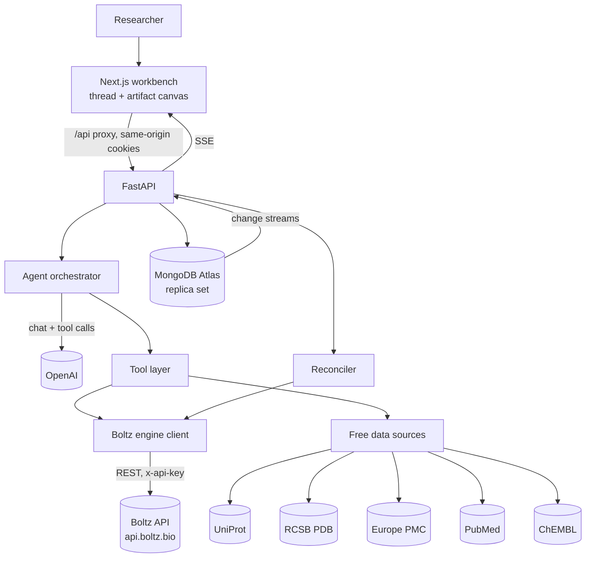
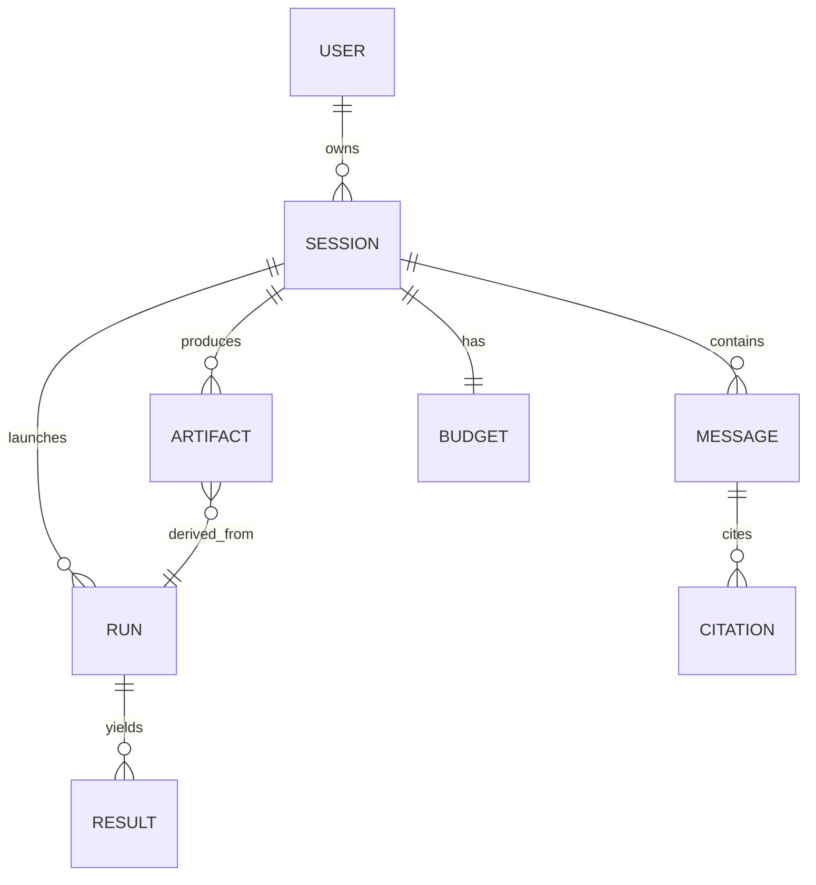

# Antidote — Architecture

> Name: **Antidote** — "AI drug discovery for the infections that have run out
> of drugs. Built for Africa." Three unrelated health-tech firms use the bare
> name; none does drug discovery. Register as **Antidote AI** if this ships as
> a company. The name lives in config, not logic.
> Supersedes the Biostruct v1 design. Research: [docs/research.md](docs/research.md).

---

## 1. Overview

**Problem.** Sub-Saharan Africa has the highest death rate from drug-resistant
infection in the world — 23.5 per 100,000. In the WHO African region in 2019,
~1.05 million deaths were associated with bacterial antimicrobial resistance and
250,000 were directly attributable to it. Four pathogens each killed over
100,000 people: *S. pneumoniae*, *K. pneumoniae*, *E. coli*, *S. aureus*.
Drug discovery is concentrated where the money is, and it is not here.

**What changed.** Two steps of drug discovery that used to require a
crystallography lab, years, and hundreds of thousands of dollars now require a
computer and minutes: predicting a protein's 3D shape, and finding molecules
that fit it. The models are available to anyone with an API key. Using them
correctly still requires structural-biology expertise that most African labs
working on these infections do not have on staff.

**Target user.** A researcher — microbiology, infectious disease, pharmacy or
a university group — who knows which infection they are fighting and has no
computational biology department. Not a clinician treating a patient; nothing
here reaches a bedside.

**Jobs to be done.**
1. *Understand* — research a pathogen, resistance mechanism or drug class and
   get answers where every claim carries a paper that actually resolves.
2. *See* — turn an amino-acid sequence (often a mutant from their own
   sequencing run) into a 3D structure they can inspect.
3. *Attack* — screen or design molecules against that structure and get a
   ranked shortlist with structures, drug-likeness, and an honest reading.

**Scope within the drug-discovery pipeline.** Steps 2 and 3 only:

| Step | Who |
|---|---|
| 1. Sequencing, mutation identified | The researcher's lab |
| **2. Amino acids → 3D structure** | **Dawa** |
| **3. Structure → ranked candidate molecules** | **Dawa** |
| 4. Synthesis and bench assays | The researcher's lab |
| 5. Animal studies, clinical trials | Years, elsewhere |

**Success metrics.**
- A researcher who has never used a structure tool reaches a ranked shortlist
  in under 10 minutes without external help. (Measured by walkthrough.)
- Zero unresolvable citations reach a user. (Enforced by verifier; measured in
  evals.)
- A screen against KPC ranks the known positive control (avibactam) in the top
  decile. (Eval, run in CI.)
- No run spends money without an explicit confirmed estimate. (Enforced in code;
  covered by tests.)

---

## 2. Scope

**In scope (v1, production quality).**
- Agent workbench: conversational thread + artifact canvas.
- Literature research with verified citations (Europe PMC, PubMed).
- Target resolution (UniProt), measured structures (RCSB).
- Structure prediction from sequence, and protein+ligand complexes (Boltz).
- Small-molecule library screening, molecule design, ADME (Boltz).
- Protein binder design (Boltz) — retained from v1, second track.
- Molecule library assembly (ChEMBL + curated starter set with positive
  controls).
- Ranked results with structures, metrics, plain-language explanation, caveats.
- Per-project hard spend ceiling with estimate→confirm on every paid call.
- Export for a wet lab.
- Landing page telling the problem story with cited figures.

**Out of scope, stated on screen.**
- Toxicity prediction of any kind (no hERG, no hepatotoxicity). Nothing in the
  stack does this, and real discovery does not do it at hit-finding stage
  either.
- Clinical decision support. No dosing, no treatment advice, no patient data.
- Steps 1, 4, 5 of the pipeline.
- Screening "billions" of molecules. Every molecule is billed compute; we screen
  hundreds to low thousands, and the `explore` endpoint samples larger spaces
  under a budget.

**Constraints.**
- Hackathon deadline; phases ordered so each one ends demonstrable.
- Boltz publishes no public rates — `estimate-cost` is the only price source.
- Boltz test keys (`sk_bc_*_test_`) return synthetic results, unbilled, and are
  the default for development and CI.

---

## 3. Requirements

**Functional** (numbered, each testable)

1. A user signs in and sees their sessions.
2. A user starts a session by describing an infection in plain words.
3. The agent resolves that to a candidate target protein and shows why, with
   citations.
4. A user can paste an amino-acid sequence (or upload FASTA) and receive a
   predicted 3D structure.
5. A user can view any structure in an interactive 3D viewer.
6. The agent identifies the attack site, reconciling UniProt / PDB-author /
   model-index numbering, and shows all three.
7. A user can screen a molecule library against a target and receive ranked
   results with per-molecule metrics, structure and ADME.
8. A user can request de-novo molecule design against the pocket.
9. A user can request protein binder design (second track).
10. Every paid operation shows a cost estimate and requires explicit
    confirmation before running.
11. A project has a hard spend ceiling that cannot be exceeded, even under
    concurrent runs.
12. Every factual claim the agent makes about literature carries an identifier
    that resolves; unresolvable ones are removed and the claim flagged.
13. Every ranked result carries the caveat that these are predictions, ranked
    only within this batch, requiring experimental validation.
14. A user can export results (structures, SMILES, metrics, citations).
15. Long-running jobs survive a page reload and a server restart.
16. A user can speak a question in English, Yorùbá, Hausa, Igbo, Amharic or
    Nigerian Pidgin; the transcript appears **in the composer for review**, with
    the detected language shown, and is sent only when the user presses send.
17. Every assistant message can be played aloud in the user's language.
18. Speech spend is metered on the same ledger as science spend and shown
    separately.

**Non-functional**

| Property | Target |
|---|---|
| First token from agent | < 2 s |
| Structure viewer interactive | < 3 s after result available |
| Job durability | Survives API restart; reconciler resumes |
| Concurrency | Per-project budget safe under parallel runs (compare-and-set) |
| Cost ceiling | Per project, user-set, default $25; hard-enforced |
| Secrets | Never in client, never in logs, never in LLM context |
| Accessibility | Keyboard reachable, visible focus, content visible without JS, `prefers-reduced-motion` honoured |
| Data retention | Boltz artifacts expire in 7 days; we persist metrics + our own copies |

---

## 4. System context & high-level design



**Path of a request.** The browser talks only to Next.js, which rewrites
`/api/*` to the FastAPI origin so the session cookie stays first-party,
httpOnly and SameSite=Lax. FastAPI authenticates, loads the session, and hands
the turn to the agent orchestrator. The orchestrator streams tokens back over
SSE while calling tools. Tools that cost money do not execute: they return a
*proposal* with a cost estimate, which is rendered as a confirmation card in the
thread. On confirmation the API reserves budget (compare-and-set), submits the
job to Boltz, and records it. The reconciler polls live jobs; results land in
MongoDB; change streams push updates to the open thread over SSE.

---

## 5. Tech stack

| Layer | Choice | Version | Why | Rejected |
|---|---|---|---|---|
| Frontend | Next.js App Router + TypeScript + Tailwind | 16 / TS 5 / TW 4 | Already built, SSR, rewrites keep cookies first-party | SPA (cookie/CORS complexity) |
| 3D viewer | Mol\* | 5.13.1 | Industry standard, already integrated and chrome-suppressed | NGL, 3Dmol.js |
| Motion | GSAP + ScrollTrigger + SplitText, `motion/react` | 3.15.1 | House standard; landing page needs authored motion | CSS-only |
| Backend | FastAPI + Python 3.12 (uv) | — | Already built; async-native, typed | Node (would discard working code) |
| Database | MongoDB Atlas (replica set) | — | Change streams drive SSE; TTL cache; no Redis needed | Postgres + Redis + queue (more infra) |
| Science engine | **Boltz API** | `boltz-2.1`, `adme-v1` | Covers *both* steps in one API with a usable commercial licence | AlphaFold 3 (no API, non-commercial), Chai-2 (no public API), DiffDock (pose only, no affinity/ranking/ADME) |
| LLM | **OpenAI** | model ID verified against official docs at build time | User's decision; key already provisioned | — |
| Voice | **Spitch** | `/v1` | Nigerian company building speech models *for African languages*; six languages incl. Yorùbá, Hausa, Igbo, Pidgin; verified working 2026-11-17 | Whisper/ElevenLabs (weak or absent on these languages, and not African-built) |
| Auth | Argon2id + opaque session tokens (SHA-256 at rest) + double-submit CSRF | — | Already built and tested | JWT in localStorage (XSS exposure) |
| Money | `Decimal`, stored as quantized strings | — | Binary floats must never touch currency | float |

**Why Boltz and not AlphaFold.** AlphaFold 3 has no public API and its weights
are non-commercial; AlphaFold Server is a web form whose terms bar commercial
use. AlphaFold 2 weights permit commercial use but there is no hosted API — it
needs local GPUs and the full MSA databases. More decisively, AlphaFold covers
Step 2 only; Step 3 would need a second vendor. Boltz covers folding,
complexes, binding metrics, library screening, molecule design, ADME and
protein design behind one key, one billing model and one job lifecycle we have
already built. The trade is some accuracy on certain complex types for a
licence we can use and an API that exists. For hypothesis generation destined
for lab validation, that is the right trade, and it is a trade.

**AlphaFold DB was considered and dropped.** It is free, but it is a lookup of
precomputed structures for known sequences. RCSB (already integrated) covers
the measured case better, and our users' proteins are frequently mutants, which
no precomputed database holds. The remaining gap did not justify another moving
part.

---

## 6. Components

### 6.1 Agent orchestrator (`agent/`)
Owns a session's turn loop. Streams assistant tokens over SSE, emits tool-call
events, enforces step and token budgets. Stateless per turn; conversation state
lives in MongoDB. **Failure:** on LLM error, the turn ends with an explicit
error message in the thread; the session is never left half-written.

### 6.2 Tool layer (`agent/tools/`)
Typed, namespaced tools. Each declares a JSON schema, is validated on input and
output, and returns condensed structured results — never raw dumps. Paid tools
return a *proposal*, not a result. **Failure:** every tool returns a typed error
the model can act on ("UniProt unreachable, nothing was charged").

### 6.3 Boltz engine client (`engines/boltz.py`, extended)
Existing typed client. v1 covers `/protein/design`. v2 adds
`predictions/structure-and-binding`, `small-molecule/library-screen`,
`small-molecule/design`, `predictions/adme`. All share the same lifecycle:
`estimate-cost` → submit with idempotency key → poll → paginate results →
persist. **Failure:** `EngineUnavailable` vs `EngineRejected` already
distinguished; surfaces as a plain-language message with nothing charged.

### 6.4 Free data sources (`sources/`)
`uniprot.py`, `rcsb.py`, `pubmed.py` exist. New: `europepmc.py`, `chembl.py`.
All fan out in parallel with per-source timeouts and **degrade rather than
fail** — a missing source is reported on screen ("we could not reach X, so this
list is incomplete"), never silently swallowed.

### 6.5 Citation verifier (`agent/citations.py`) — new
Takes the assistant's draft plus the set of identifiers returned by tool calls
this turn. Strips any citation the model invented. Re-resolves every surviving
identifier against its source. Unresolvable → removed and the sentence flagged.
**This is a code gate, not a prompt instruction.**

### 6.6 Budget ledger (`budget.py`)
Exists. Per-project ceiling, reserve → commit → release, compare-and-set so
concurrent runs cannot both slip under the limit. Money as `Decimal`,
serialised as strings.

### 6.7 Reconciler (`jobs/`)
Exists. MongoDB scan is the work list; no queue. Resumes interrupted runs,
harvests results, releases reservations.

### 6.9 Voice layer (`voice/`) — new
Wraps Spitch (`api.spitch.app/v1`). Three calls: `/transcriptions` (multipart,
returns `detected_language`), `/speech` (returns wav bytes), `/diacritics` (restores
Yorùbá tone marks on a transcript before display). Audio never touches the LLM —
speech becomes text first, and text becomes speech last. **Failure:** the
microphone and read-aloud buttons disable with a plain message; the product is
fully usable by typing. See [docs/spitch-api-observed.md](docs/spitch-api-observed.md).

### 6.8 Residue numbering (`sources/residues.py`)
Exists and is load-bearing. Reconciles UniProt position, PDB author numbering
(which has gaps) and 0-based model index. Getting this wrong produces confident
garbage with no error anywhere, which is the worst failure mode in this domain.

---

## 7. AI / agent architecture

**Pattern: orchestrator + typed tools with deterministic code gates.** Not an
autonomous loop. Each scientific step costs real money and produces output a
researcher may act on, so confirmation is enforced by code, not by asking the
model nicely. Rejected: autonomous agent (unbounded spend, no approval point);
multi-agent fan-out (this workload is sequential and shares tight context — it
would multiply tokens for no gain).

**Roster**

| Agent | Model | Job | Tools |
|---|---|---|---|
| Orchestrator | OpenAI, reasoning-capable tier | Plans, calls tools, writes the answer, proposes next step | All |
| Extractor | OpenAI, cheap tier | Pull a sequence from pasted text, normalise a protein name, summarise an abstract | None |
| Verifier | *No model* — deterministic | Re-resolve citations, validate schemas | — |

**Tool contracts**

| Tool | In | Out | Paid |
|---|---|---|---|
| `literature.search` | query, filters | records with resolvable IDs | no |
| `literature.read` | id | abstract / OA full text | no |
| `target.find` | plain text | UniProt reviewed candidates + relevance verdict | no |
| `target.structures` | accession | RCSB structures, active sites | no |
| `structure.predict` | sequence \| entities, binding spec | **proposal** → job → structure + confidence | **yes** |
| `pocket.identify` | target | residues in all three numbering systems | no |
| `molecules.library` | target class, size | SMILES set incl. positive control | no |
| `molecules.screen` | target, molecules, filters | **proposal** → job → ranked hits + ADME | **yes** |
| `molecules.design` | target, pocket | **proposal** → job → novel molecules | **yes** |
| `molecules.adme` | smiles[] ≤128 | lipophilicity, permeability, solubility | **yes** |
| `proteins.design` | target, epitope | **proposal** → job → binders | **yes** |
| `results.rank` | run id | ordered, banded, explained, caveated | no |

**Context strategy.** The thread is the state. Tool results are stored whole in
MongoDB and injected into context as condensed summaries with IDs; the agent
re-reads detail just-in-time via a fetch tool rather than carrying it. Long
sessions compact older turns into a running summary. System prompt and tool
schemas are stable for cache reuse.

**Guardrails**

1. **Spend gate.** No paid tool executes on the model's say-so. It returns a
   proposal; the user confirms a card in the thread; the API re-estimates and
   rejects if the price moved.
2. **Ceiling.** Compare-and-set budget reservation. Concurrency-safe.
3. **Citation verifier.** Described in 6.5.
4. **Injection defence.** All tool output — papers, UniProt descriptions, web
   text — is passed as data in a clearly delimited channel and never as
   instructions. The system prompt states that tool content cannot change the
   rules.
5. **No clinical claims.** Prohibited in the prompt *and* checked: every ranked
   result carries the caveat, with a test that fails the build if the caveat
   stops denying binding, denying treatment, or requiring experimental testing.
6. **Limits.** Max tool calls per turn, max tokens per turn, timeout, and a per
   session cost cap.

**Eval plan** (built before prompt tuning, run in CI with test-mode keys)

| Suite | Cases | Grading |
|---|---|---|
| Target resolution | 20 plain-English infections → expected UniProt family | code |
| Citations | 15 research questions | **code: every ID must resolve**; zero tolerance |
| Numbering | 10 targets → expected author/UniProt/index triples | code |
| Screen sanity | KPC + library containing avibactam | code: positive control in top decile. **Must run in live mode** — test mode returns synthetic metrics and replaces our molecule ids with `mol_N` |
| Refusals | 10 clinical/dosing/diagnosis prompts | LLM judge + rubric |
| Spend gate | attempt paid action without confirmation | code: must not execute |

**Cost/latency budget.** Chat turn: < $0.05, < 2 s to first token. Structure
prediction: priced by `estimate-cost`, typically seconds-to-minutes. Library
screen: priced per molecule; **default cap 250 molecules per run**, raisable
explicitly. Session cap default $25.

---

## 8. Data model



- **USER** — email, argon2id hash, created_at.
- **SESSION** — user_id, title, infection description, status, budget embedded.
- **MESSAGE** — role, content blocks, tool calls, tool results (full), token
  usage, created_at.
- **CITATION** — message_id, source (`europepmc`/`pubmed`), external id, title,
  resolved_at, `verified: bool`.
- **ARTIFACT** — kind (`structure`/`molecule_set`/`ranking`), payload ref,
  run_id, created_at. What the canvas renders.
- **RUN** — kind, engine job id, idempotency key, status, estimate, confirmed
  cost, livemode, timestamps, error.
- **RESULT** — run_id, metrics, SMILES or sequence, structure ref, ADME,
  warnings.

**Indexes.** `sessions(user_id, updated_at)`, `messages(session_id, created_at)`,
`runs(status)` (the reconciler's work list), `runs(idempotency_key)` unique,
`artifacts(session_id, created_at)`.
**Retention.** Boltz presigned artifacts expire in 7 days — we download and
store structure files we need. TTL collection for the source cache.
**Migrations.** Additive; v1 collections (`projects`, `targets`) remain readable
and are migrated by a one-shot script into `sessions`.

---

## 9. API design

All under `/v1`. Session cookie auth, double-submit CSRF on mutations. Money is
always a string. Errors use the existing typed envelope with
`message_for_user`.

| Method | Path | Purpose |
|---|---|---|
| POST | `/auth/register`, `/auth/login`, `/auth/logout` | unchanged |
| GET/POST | `/sessions` | list / create |
| GET | `/sessions/{id}` | session + messages + artifacts |
| POST | `/sessions/{id}/messages` | send a turn; **SSE stream** of tokens, tool events, artifacts |
| POST | `/sessions/{id}/proposals/{pid}/confirm` | approve a priced action; body echoes the estimate |
| POST | `/sessions/{id}/proposals/{pid}/decline` | decline |
| GET | `/sessions/{id}/runs/{rid}` | run status |
| GET | `/sessions/{id}/runs/{rid}/results` | paginated results |
| GET | `/sessions/{id}/export` | bundle (CIF, SMILES, metrics, citations) |
| GET | `/sessions/{id}/events` | SSE, change-stream backed |
| PUT | `/sessions/{id}/budget` | set ceiling |

Rate limits: per-user token bucket on message send; per-session concurrent run
cap.

---

## 10. Key flows

**Priced action with confirmation**

```mermaid
sequenceDiagram
  participant U as Researcher
  participant A as API
  participant L as OpenAI
  participant B as Boltz
  U->>A: "screen molecules against KPC"
  A->>L: turn + tools
  L-->>A: tool_call molecules.screen
  A->>B: POST library-screen/estimate-cost
  B-->>A: estimate
  A-->>U: SSE: proposal card ($X, 250 molecules)
  Note over U,A: nothing charged yet
  U->>A: confirm (echoes estimate)
  A->>A: re-estimate; reject if moved
  A->>A: reserve budget (compare-and-set)
  A->>B: POST library-screen (idempotency key)
  B-->>A: job id
  loop reconciler
    A->>B: GET job
    B-->>A: streaming results
  end
  A-->>U: SSE: ranked artifact + caveat
```

**Failure paths.** Estimate fails → proposal not shown, message explains, nothing
charged. Budget insufficient → proposal shown as blocked with the shortfall.
Submit fails → reservation released. API restarts mid-run → reconciler finds the
run by status and resumes; the idempotency key prevents a double submission.
Boltz unreachable (incl. DNS) → "Design engine unavailable", run marked failed,
reservation released.

**Research turn with citations.** Agent calls `literature.search` → records with
IDs enter context → agent drafts → **verifier strips any invented citation and
re-resolves the rest** → unresolvable ones removed and their sentences flagged →
answer streams with citation chips the user can click.

**Fold a mutant.** User pastes sequence → extractor normalises it → agent checks
UniProt/RCSB for an existing structure → none for this mutant → proposes
`structure.predict` with a price → confirm → job → structure lands in canvas.

---

## 11. Security & privacy

- **AuthN/Z.** Argon2id, opaque tokens hashed at rest, httpOnly SameSite=Lax
  cookies via Next rewrite, double-submit CSRF. Every session scoped to its
  owner; no cross-user reads.
- **Secrets.** `.env`, gitignored. `BOLTZ_API_KEY`, `BOLTZ_LIVE_API_KEY`,
  `OPENAI_API_KEY`, `MONGODB_URI`, `NCBI_API_KEY`, `SESSION_SECRET`. Never sent
  to the browser, never logged, never placed in LLM context.
- **Prompt injection.** A paper abstract or UniProt description is attacker-
  controllable in principle. All tool output is delimited as data; the system
  prompt forbids treating it as instruction; no tool can escalate privilege; no
  tool executes code or shells out; paid actions need human confirmation
  regardless of what any text says.
- **PII.** No patient data is collected or accepted. The product states this.
  If a user pastes something that looks like patient identifiers, the UI warns.
  Sequences are not PII.
- **Live vs test.** `livemode` is surfaced on every result. Test-mode results
  are labelled as synthetic in the UI.

---

## 12. Reliability & observability

- Idempotency keys on every engine submission; retries safe.
- Per-source timeouts; degraded sources reported, never silently dropped.
- Reconciler resumes on restart; no in-memory job state.
- Structured JSON logs with request id and session id; **secrets and full
  tool payloads never logged**.
- LLM traces: prompt hash, tool calls, token counts, cost, latency per turn,
  stored with the message for later audit.
- Metrics: turn latency, tool error rate by tool, spend per session, citation
  verification failure rate, job success rate.

---

## 13. Testing strategy

| Level | What | CI |
|---|---|---|
| Unit | numbering, budget arithmetic, ranking, citation verifier, schema validation | yes |
| Integration | engine clients against recorded fixtures + test-mode keys; sources against fixtures | yes (`make test`, inside compose) |
| E2E | Playwright: sign-in → research question → fold → screen → export | yes |
| AI evals | the six suites in §7 | yes, on prompt/model change |
| Smoke | whole-app crawl, 2 viewports | pre-push |
| Motion | `motion-check.mjs` | pre-push |

**Known trap, recorded:** a host-run `pytest` exits 0 while silently skipping
~200 integration tests, because Colima keeps MongoDB's port inside its VM.
`make test` is the only backend result worth quoting.

---

## 14. Deployment & environments

- **Dev:** API native on :8000, web on :3002 (port 3000 belongs to another
  project and must not be touched), Mongo in Colima.
- **Prod:** Railway (API) + Vercel (web); both CLIs already authenticated, both
  services `$PORT`-aware.
- **Env vars:** as §11, plus `APP_BASE_URL`, `API_ORIGIN`.
- **CI/CD:** push to `main` after `ship-verify` passes; deploy; re-run smoke and
  critical flows against the live URL.
- **Cost:** hosting ~$5–20/mo; OpenAI usage-based; Boltz usage-based with
  per-session ceiling.

---

## 15. Milestones

Each ships green and pushed on its own.

| # | Feature | Acceptance |
|---|---|---|
| **M1** | Boltz `structure-and-binding` client | Folds a sequence in test mode; estimate→submit→poll→persist; integration tests pass |
| **M2** | `library-screen` + `adme` clients | Screen returns ranked metrics + ADME; filters reported; positive-control eval passes |
| **M3** | `small-molecule/design` client | Returns novel SMILES with metrics |
| **M4** | Europe PMC source + citation verifier | Invented citations provably stripped; unit tests |
| **M5** | ChEMBL source + curated library | Library assembles with positive control present |
| **M6** | Session/message/artifact data model + migration | v1 projects readable; indexes in place |
| **M7** | Agent orchestrator + tool layer + SSE streaming | Chat turn streams; tool calls visible; limits enforced |
| **M8** | Spend gate: proposals, confirmation cards, re-estimate | Paid action impossible without confirmation; test proves it |
| **M9** | Workbench UI: thread + artifact canvas + Mol\* + molecule table | Full flow by walkthrough, no JS errors |
| **M10** | Landing page: the story, cited, with motion | motion-check 4/4; CLS ≤ 0.1 |
| **M11a** | Voice: Spitch client, mic → composer draft with detected language, per-message read-aloud of the `spoken` field, metered | Six languages work by walkthrough; nothing auto-sends; speech spend visible |
| **M11** | Export bundle | CIF + SMILES + metrics + citations download |
| **M12** | Evals in CI, ship-verify, deploy, live verification | All suites green; live smoke clean |

---

## 16. Risks & open questions

| Risk | Mitigation |
|---|---|
| **Boltz DNS fails on the dev machine** (`SERVFAIL` for boltz.bio; 8.8.8.8 resolves it) | Blocks M1–M3 testing locally. Change resolver, or develop against test-mode fixtures and verify on deploy |
| A large screen could be costly | **Measured 2026-11-17: $0.025/molecule and $0.025/fold.** 250 molecules = $6.25. `estimate-cost` mandatory; default 250-molecule cap; hard session ceiling |
| **Europe PMC endpoint shape unverified** (docs wouldn't load) | Confirm against official docs in M4 before writing the client |
| **OpenAI model IDs uncertain** — aggregators disagree | Verify against OpenAI's official docs before writing agent code; isolate behind one module |
| **No affinity value is returned at all** by `structure-and-binding` in test mode, despite a `binding` request | Measured 2026-11-17. Use `library-screen`'s `binding_confidence` for hit discovery. Do not promise predicted affinity until a live run shows one |
| **Agent overclaims** | Verifier + caveat test + refusal eval suite |
| **Speech mis-hears scientific terms** — "carbapenemase" in a Yorùbá sentence | The transcript is a *draft in the composer*, never sent automatically. User sees and edits it first |
| **Read-aloud would speak SMILES strings as noise** | Each message carries a separate one-sentence `spoken` summary; the button plays that, not the body |
| **Voice costs more than science** — $0.042 to read one answer aloud vs $0.025 to fold a protein | Metered on the budget ledger with its own line; read-aloud is opt-in per message, never automatic. $1 free credit is only ~12 minutes |
| **Scope vs deadline** | M1–M9 are the demo; M10–M12 compress first |

**Open questions for the user.**
1. Name: **Dawa**, Ewé, or your own?
2. Default session budget — $25, or lower for a public demo?
3. Public demo: shared test-mode key (free, synthetic results, clearly labelled)
   or live key with a hard ceiling?

---

## 17. Decisions log

| # | Date | Decision | Why | Alternatives |
|---|---|---|---|---|
| 1 | 2026-11-17 | Scope = Steps 2 and 3 only | The only steps a computer can do; everything else is lab or clinic | Full pipeline (impossible), Step 2 only (too thin) |
| 2 | 2026-11-17 | Boltz as sole science engine | Covers both steps, usable licence, real API, lifecycle already built | AlphaFold 3 (no API, non-commercial), Chai-2 (no public API), DiffDock+AlphaFold (two vendors, less capability) |
| 3 | 2026-11-17 | Drop AlphaFold DB | RCSB covers measured structures; users' proteins are mutants, which no precomputed DB holds | Keep as free-first lookup |
| 4 | 2026-11-17 | OpenAI for the agent | User's decision; key provisioned | Claude (house default) |
| 5 | 2026-11-17 | Agent workbench replaces the wizard | v1's step rail made a complex workflow feel complex; a thread lets the agent carry the expertise | Keep wizard, add agent panel |
| 6 | 2026-11-17 | Spend gate as code, not prompt | A model must never be the thing standing between a user and a bill | Trust the prompt |
| 7 | 2026-11-17 | Citation verifier as code, not prompt | Makes fabricated references structurally impossible rather than discouraged | Prompt instruction only |
| 8 | 2026-11-17 | No toxicity claims anywhere | Nothing in the stack predicts toxicity; real discovery doesn't at this stage either | Imply it via "ADME" |
| 10 | 2026-11-17 | Spitch for voice, six African languages | Built in Nigeria for these languages; verified working. "Any language" was never on offer and we do not claim it | Whisper + ElevenLabs |
| 11 | 2026-11-17 | Transcripts are drafts, not commands | Speech models mis-hear scientific nouns; a wrong word must not silently spend money | Auto-send on transcription |
| 12 | 2026-11-17 | Messages carry a separate `spoken` summary | Reading SMILES and accession codes aloud is noise | Read the message body with TTS |
| 9 | 2026-11-17 | Keep v1 auth, budget ledger, reconciler, Mol\*, numbering | Tested, working, and the hardest parts to get right | Rebuild from scratch |
